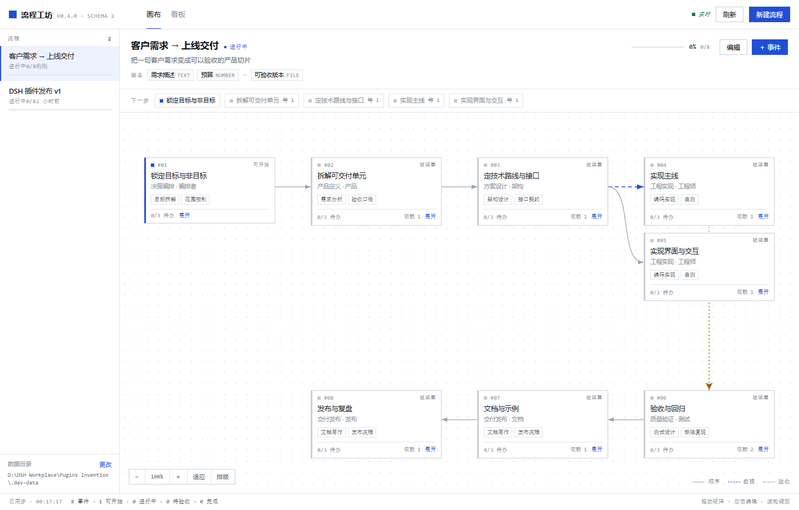
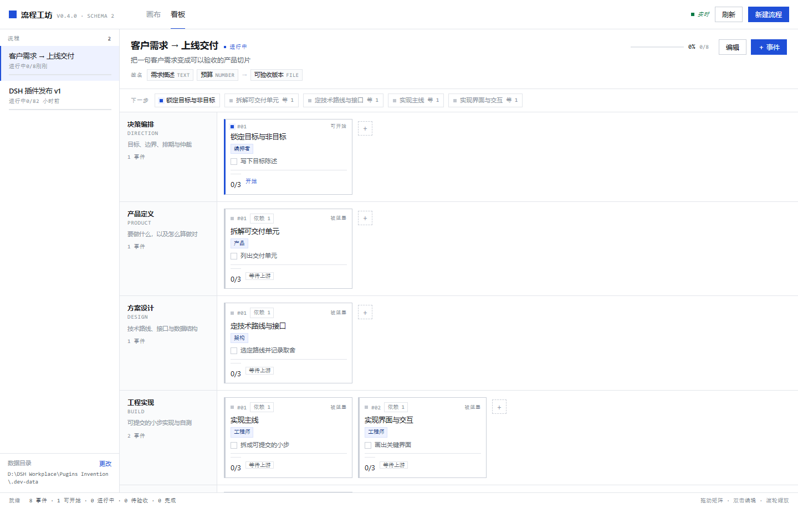

# 流程工坊 · Workflow Studio

> 把一次项目分工拆成**按服务职能分层的、有先后顺序的事件**，每个事件自带待办清单、依赖和验收口径；agent 与人在同一张看板上推进。



事件还能摆成**自由拖拽的矩阵画布**：每一格是一个矩阵，格子里写任务、技能、输出格式和建议，连线就是依赖，子矩阵再往下钻一层。

同一份数据也能按服务职能摊成看板，拖动换道：



这是 DeepSeek Harness 的一个插件：它同时给 **agent** 和 **人** 提供工作入口。

- **agent 侧**：一个 `workflow` 工具。模型把项目拆成事件、勾掉待办、查询「现在能做什么」，读回来的是一张排版好的文字看板；要派活时用 `prompt` 拿一张单节点的「派工单」。
- **人侧**：一个可视化编辑页。左侧流程列表、中间「画布 / 看板」两视图（默认画布）、右侧事件详情、SSE 实时同步。
- **同一份数据**：宿主端一个 JSON 库，两边共用；一边改，另一边立刻看到。

## 为什么这样设计

Coze 式的智能体工作模式里，最值钱的是**事件视图**：不是一串对话，而是一组各自有目标、有依赖、有完成定义的节点。项目分工也长这样 —— 谁先做、谁依赖谁、每一步要交出什么。

因此本插件把「流程」建模成三层，用途一眼可分：

| 层 | 是什么 | 例子 |
| --- | --- | --- |
| 泳道（layer） | 服务职能分层，固定 6 条 | 决策编排 / 产品定义 / 方案设计 / 工程实现 / 质量验证 / 交付发布 |
| 矩阵 / 事件（event） | 一个可交付的小事件，属于某条泳道；画布上是一个可拖拽的格子 | 「拆解可交付单元」 |
| 待办（task） | 事件内部的执行清单 | 「为每个单元写验收口径」 |
| 子矩阵（child） | 把一个事件展开成独立流程，内部再分工 | 「支付模块」里的接口设计 / 联调 / 回归 |

每个事件还能配 **技能**、**输出格式**、**给执行者的建议**，以及画布上的自由坐标；流程本身有 **函数签名**（inputs / outputs），所以「工作流即函数」：客户给输入，流水线跑完交出可验收的输出。子矩阵通过 `parentId` / `parentNodeId` 挂回父节点，面包屑可以逐层钻回去。

事件之间的 `dependsOn` 决定先后：依赖没做完就是 `blocked`，做完了自动变 `ready`；事件内待办全部勾上，自动进 `review`。这样「下一步做什么」是**算出来的**，不是猜出来的。画布上的连线就是这份依赖关系，拖动格子只改坐标，不改依赖。

### 三种连线，三种含义

依赖本身有语义，页面上用不同的线画出来，一眼能分清是哪一种：

| 连线 | 样子 | 含义 |
| --- | --- | --- |
| 顺序 `flow` | 灰色实线 | 默认：上一步做完才轮到我 |
| 数据 `data` | 蓝色虚线 | 上游把手里的产出交给我，我接着往下做 |
| 验收 `gate` | 琥珀点线 | 我要等上游的结论通过后才能收口（闸口） |

线的种类存在事件上（`links: {上游id: 'data' | 'gate'}`），不改 `dependsOn`，所以语义只是**标注**，不会改变解锁顺序。详情面板里每条依赖旁边有三个小按钮，点一下就换线型。

### 观感

界面是刻意做得「安静」的：纸白底、单色蓝、零圆角、1px 细线，编号和标签用等宽字体，颜色只用来表达状态（可开始 / 进行中 / 待验收 / 已完成）。没有渐变、没有发光、没有大圆角卡片 —— 信息密度靠排版和留白撑起来，而不是靠装饰。

## 安装

插件可以直接从仓库装进某个 profile：

```bash
# 1) 装进 profile（会把依赖写进 profile 的 package.json 并登记 bundle）
dsh plugin --profile desktop add "git+https://github.com/woem2436/dsh-workflow-studio.git"

# 2) 侧栏即出现「流程工坊」（profile 会热加载；个别版本需要重启一次）
```

改本地代码时用 `file:` 装更顺手（免发布）：

```bash
dsh plugin --profile desktop add "file:D:/DSH Workplace/Pugins Invention"
```

> 两个坑：
> 1. `file:` 装的是**目录引用**，桌面版启动时按这个路径找插件；目录挪走或删掉，插件就加载不出来。要长期用就换成 `git+` 或 npm 源。
> 2. pnpm 对 `file:` 依赖是**硬链接复制**，改完源码必须重装一次才会生效（`remove` 再 `add`），宿主半（`index.js`/`lib/`）还要重启 DSH；只有页面文件刷新就能看新内容是因为它走硬链接同一份 inode —— 编辑后刷新页面即可，不用重装。

卸载：

```bash
dsh plugin --profile desktop remove dsh-workflow-studio
```

## 数据目录

流程是普通 JSON 文件，存在哪个目录由下面四个来源**依次决定**（前面的赢）：

| 优先级 | 来源 | 说明 |
| --- | --- | --- |
| 1 | 插件配置 `dataDir` | `cordis.patch.yml` 里给 `workflow-studio` 行加 `config: { dataDir: "D:/..." }`；命中即锁定，页面上改不了 |
| 2 | 环境变量 `DSH_WORKFLOW_STUDIO_DIR` | 启动 DSH 前设置；同样锁定页面选择 |
| 3 | 页面里选的路径 | 记在 `%APPDATA%\dsh-workflow-studio\settings.json`（只存指针，几 KB） |
| 4 | 默认位置 | `$DSH_HOME/workflow-studio`，没设 `DSH_HOME` 时是 `~/.dsh/workflow-studio` |

在编辑页左下角点「更改」，选盘符、填绝对路径，勾「把现有流程复制过去」就会把当前所有流程搬到新目录并从新目录继续读写；「恢复默认」把指针清空、回到默认位置。

agent 也能搬：

```text
workflow(action="relocate", dataDir="E:/workflow-data")
```

备份/迁移就是拷目录；多实例共用同一个 `DSH_HOME` 时，各自设 `dataDir` 即可互不干扰。

## 用起来

### 人在画布上

- 打开就是「画布」：每个事件是一张矩阵卡片，卡片右侧拉出连线指向依赖它的格子，线的样式表示依赖语义（顺序 / 数据 / 验收）。
- 空白处按住拖 = 平移，滚轮 = 缩放，「适应」一键让整张图落在视野里，「自动排版」按依赖深度排成蛇形两段（长链也不会缩成一条细线）。
- 卡片右下角「展开」把这一格变成子矩阵（独立的空白流程）并直接钻进去，面包屑「父流程 / 子矩阵」可逐层返回；已经展开的显示「进入」。
- 双击卡片开右侧详情：状态、角色、依赖（每条依赖可切换连线语义）、待办、验收，以及「执行说明」里的技能 / 输出格式 / 建议。
- 看板视图保留：卡片拖到别的泳道即换职能层，拖到同泳道不同位置即改顺序。

### agent 在心里有一张图

工具名 `workflow`，一个工具 16 个 action。典型用法：

```text
workflow(action="create", name="发版 v0.1", template="project")     # 先拿骨架
workflow(action="list")                                            # 有哪些流程
workflow(action="next")                                            # 现在能做哪些
workflow(action="add_event", title="写迁移脚本", layer="build",
         dependsOn=["定技术路线与接口"], tasks=["写 SQL", "在影子库跑通"],
         skills=["数据库迁移"], outputFormat="migrations/*.sql + 回滚脚本")
workflow(action="set_task", event="写迁移脚本", task="写 SQL", done=true)
workflow(action="update_event", event="写迁移脚本", status="review")
workflow(action="child", event="支付模块", name="支付模块 · 实现")   # 展开子矩阵
workflow(action="prompt", event="写迁移脚本")                       # 拿这张派工单去干活
```

`prompt` 返回的是一张可以直接喂给 subagent 的单节点契约：角色、需要的技能、待办、输出格式、上游产出、下游消费者、验收口径。`inputs` / `outputs` 用 `"名称|类型|说明"` 写函数签名：

```text
workflow(action="create", name="周报流水线",
         inputs=["素材|text|本周的提交与讨论"], outputs=["周报|file|Markdown 文件"])
```

返回的是文字看板，所以模型不需要额外解释就能接着做下一步：

```text
发版 v0.1 · 2 个事件可开始 · 40% 完成

── 决策编排 · 目标、边界、排期与仲裁 ──
  ✓ 锁定目标与非目标 (done)  #1
── 产品定义 · 要做什么，以及怎么算做好 ──
  ▸ 拆解可交付单元 (doing)  #1  待办 1/3
...
```

## HTTP 接口

页面就是这套接口的客户端，你也可以拿它做自动化：

| 方法 | 路径 | 说明 |
| --- | --- | --- |
| GET | `/workflow-studio/api/meta` | 插件版本、数据目录、泳道、状态、模板 |
| GET | `/workflow-studio/api/workflows` | 流程列表（含进度摘要） |
| POST | `/workflow-studio/api/workflows` | 新建流程 `{name, goal, template}` |
| GET | `/workflow-studio/api/workflows/:id` | 完整流程 + 进度 + 下一步 |
| PATCH | `/workflow-studio/api/workflows/:id` | 改流程级字段 |
| DELETE | `/workflow-studio/api/workflows/:id` | 删流程 |
| POST | `/workflow-studio/api/workflows/:id/events` | 加事件 |
| PATCH | `/workflow-studio/api/workflows/:id/events/:eventId` | 改事件 |
| DELETE | `/workflow-studio/api/workflows/:id/events/:eventId` | 删事件 |
| POST | `/workflow-studio/api/workflows/:id/events/:eventId/move` | 换道 / 改顺序 |
| POST | `/workflow-studio/api/workflows/:id/events/:eventId/position` | 挪画布坐标 `{x, y}` |
| POST | `/workflow-studio/api/workflows/:id/events/:eventId/child` | 展开子矩阵 `{name, goal, description, template}` |
| POST | `/workflow-studio/api/workflows/:id/layout` | 批量排版 `{positions: [{id, position}]}` |
| POST | `/workflow-studio/api/workflows/:id/tasks` | 加待办 |
| PATCH | `/workflow-studio/api/workflows/:id/tasks/:taskId` | 勾选 / 改写 |
| DELETE | `/workflow-studio/api/workflows/:id/tasks/:taskId` | 删待办 |
| GET | `/workflow-studio/api/workflows/:id/next` | 就绪事件 + 阻塞原因 |
| GET | `/workflow-studio/api/config` | 当前数据目录、来源（config/env/settings/默认）、是否锁定、可用盘符 |
| POST | `/workflow-studio/api/config` | 切目录 `{dataDir, migrate}`；`{reset: true}` 回默认；锁定时 409 |
| GET | `/workflow-studio/api/stream` | SSE：`hello` / `changed` |

`:id` 可以传流程 id，也可以传名称（唯一匹配）。错误统一 `{ "error": { "code", "message", "status" } }`。

## 开发

```bash
node dev/harness.js                        # 本地起编辑页：http://127.0.0.1:4317/workflow-studio/（页面显示目录被固定）
node dev/harness.js --unlocked --data-dir .dev-data   # 解锁模式，可在页面上换目录
node dev/dom-check.js <url> --out shot.png # 无头 Chrome 跑一遍页面并截图（含交互断言）
node dev/dom-check.js <url> --flow canvas --out shot.png   # 画布：拖拽落库、展开子矩阵、面包屑回退
node dev/dom-check.js <url> --flow shot --out docs/preview-canvas.png  # 只拍一张干净的画布图 + 校验详情面板
node dev/dom-check.js <url> --flow board --out docs/preview-board.png  # 看板：泳道/卡片/溢出检查
node dev/dom-check.js <url> --flow dialog --out shot.png   # 新建流程弹窗
node dev/dom-check.js <url> --flow config --target D:/tmp/x   # 走一遍「换数据目录」
node dev/dsh-app-check.js --url "<dsh web 打印的带 token 地址>"   # 在真实 DSH 实例里验证侧栏与面板
node dev/dsh-app-check.js --url "<…>" --seed                     # 顺手造一张演示看板再截图
node --test tests/store.test.js tests/api.test.js tests/config.test.js tests/canvas.test.js   # 52 个用例
```

- 页面是**原生 ESM，零依赖零构建**：`web/index.html` + `web/styles.css` + `web/app.js`。
- 浏览器半 `client.js` 是手写的 ModuleLoader 包：注册侧栏入口 + `main` keyed 面板，面板里 iframe 指向宿主自己服务的编辑页。改页面不需要重装插件。
- 宿主半：`index.js`（注册工具 + 挂 HTTP 路由）、`lib/store.js`（数据与状态推导）、`lib/config.js`（数据目录解析与指针文件）、`lib/api.js`（路由/静态/SSE）、`lib/tool.js`（agent 工具）、`lib/render.js`（文字看板）。

目录：

```text
index.js          host 半入口：注册 workflow 工具 + 挂 /workflow-studio 路由
client.js         浏览器半：侧栏入口 + main 面板（iframe 薄壳）
lib/store.js      流程/事件/待办/子矩阵数据层，状态推导与原子写盘
lib/config.js     数据目录：优先级解析、路径校验、指针文件
lib/api.js        HTTP 表面：JSON API、SSE、静态页、/api/config、/position、/layout、/child
lib/tool.js       agent 工具 definition（含 child / prompt 派工单）
lib/render.js     agent 读的文字看板
web/              编辑页（原生 ESM）
dev/              本地 harness、CDP 检查脚本
docs/             截图（preview-canvas.png 画布 / preview-board.png 看板 / preview-in-dsh.png 集成）
tests/            node:test 用例
```

## 限制

- 事件之间的「先后」只表达为 `dependsOn` 有向无环图；成环会被拒绝，但**不排期**（没有日期/工时）。
- 画布只做「自由摆放 + 依赖连线」：连线不能在画布上直接拉出来新增依赖，也不改变解锁顺序；连线的语义（顺序 / 数据 / 验收）在详情面板里切换。
- 子矩阵是独立流程，删父矩阵会级联删掉它的子矩阵；不支持把矩阵移动挂到别的父节点下（只能展开/删除）。
- 暂不自动拉起 subagent：v1 只做就绪度推导与状态推进，`prompt` 只产出派工单，执行仍由 agent 决定。
- 一个实例一份数据目录；多实例共享同一个 `DSH_HOME` 时请显式设置 `dataDir`。

## License

MIT