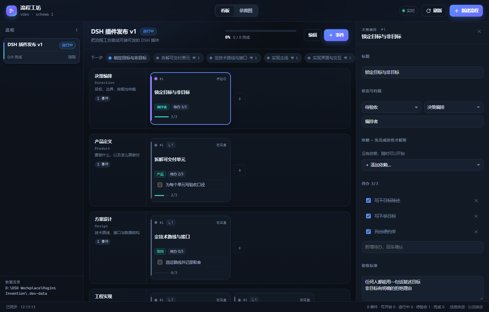

# 流程工坊 · Workflow Studio

> 把一次项目分工拆成**按服务职能分层的、有先后顺序的事件**，每个事件自带待办清单、依赖和验收口径；agent 与人在同一张看板上推进。



这是 DeepSeek Harness 的一个插件：它同时给 **agent** 和 **人** 提供工作入口。

- **agent 侧**：一个 `workflow` 工具。模型把项目拆成事件、勾掉待办、查询「现在能做什么」，读回来的是一张排版好的文字看板。
- **人侧**：一个可视化编辑页。左侧流程列表、中间泳道看板（拖拽换道 / 改顺序）、右侧事件详情、依赖图切换、SSE 实时同步。
- **同一份数据**：宿主端一个 JSON 库，两边共用；一边改，另一边立刻看到。

## 为什么这样设计

Coze 式的智能体工作模式里，最值钱的是**事件视图**：不是一串对话，而是一组各自有目标、有依赖、有完成定义的节点。项目分工也长这样 —— 谁先做、谁依赖谁、每一步要交出什么。

因此本插件把「流程」建模成三层，用途一眼可分：

| 层 | 是什么 | 例子 |
| --- | --- | --- |
| 泳道（layer） | 服务职能分层，固定 6 条 | 决策编排 / 产品定义 / 方案设计 / 工程实现 / 质量验证 / 交付发布 |
| 事件（event） | 一个可交付的小事件，属于某条泳道 | 「拆解可交付单元」 |
| 待办（task） | 事件内部的执行清单 | 「为每个单元写验收口径」 |

事件之间的 `dependsOn` 决定先后：依赖没做完就是 `blocked`，做完了自动变 `ready`；事件内待办全部勾上，自动进 `review`。这样「下一步做什么」是**算出来的**，不是猜出来的。

## 安装

插件已经可以在本地目录直接装进某个 profile：

```bash
# 1) 装进 profile（会把依赖写进 profile 的 package.json 并登记 bundle）
dsh plugin --profile desktop add "file:D:/DSH Workplace/Pugins Invention"

# 2) 侧栏即出现「流程工坊」（profile 会热加载；个别版本需要重启一次）
```

卸载：

```bash
dsh plugin --profile desktop remove dsh-workflow-studio
```

> 插件数据默认放在 `~/.dsh/workflow-studio`（设了 `DSH_HOME` 时是 `$DSH_HOME/workflow-studio`），可用环境变量 `DSH_WORKFLOW_STUDIO_DIR` 或插件配置 `dataDir` 覆盖。数据是普通 JSON 文件，备份/迁移直接拷目录。

## 用起来

### 人在看板上

- 顶部「＋ 新建流程」→ 选模板（空看板 / 项目分工 8 事件骨架）。
- 卡片拖到别的泳道即换职能层，拖到同泳道不同位置即改顺序。
- 点卡片打开右侧详情：改标题、状态、职能、角色、依赖、待办、验收、备注。
- 卡片上直接勾掉当前待办；全部勾完，状态自动进「待验收」。
- 「依赖图」标签页按依赖深度自动排版，一眼看清主链和分支。
- 看板左上角「实时」表示 SSE 已连上：agent 在对话里改数据，页面会自己刷新。

### agent 在心里有一张图

工具名 `workflow`，一个工具 13 个 action。典型用法：

```text
workflow(action="create", name="发版 v0.1", template="project")     # 先拿骨架
workflow(action="list")                                            # 有哪些流程
workflow(action="next")                                            # 现在能做哪些
workflow(action="add_event", title="写迁移脚本", layer="build",
         dependsOn=["定技术路线与接口"], tasks=["写 SQL", "在影子库跑通"])
workflow(action="set_task", event="写迁移脚本", task="写 SQL", done=true)
workflow(action="update_event", event="写迁移脚本", status="review")
```

返回的是文字看板，所以模型不需要额外解释就能接着做下一步：

```text
发版 v0.1 · 2 个事件可开始 · 40% 完成

── 决策编排 · 目标、边界、排期与仲裁 ──
  ✓ 锁定目标与非目标 (done)  #1
── 产品定义 · 要做什么，以及怎么算做好 ──
  ▸ 拆解可交付单元 (doing)  #1  待办 1/3
...
```

## HTTP 接口

页面就是这套接口的客户端，你也可以拿它做自动化：

| 方法 | 路径 | 说明 |
| --- | --- | --- |
| GET | `/workflow-studio/api/meta` | 插件版本、数据目录、泳道、状态、模板 |
| GET | `/workflow-studio/api/workflows` | 流程列表（含进度摘要） |
| POST | `/workflow-studio/api/workflows` | 新建流程 `{name, goal, template}` |
| GET | `/workflow-studio/api/workflows/:id` | 完整流程 + 进度 + 下一步 |
| PATCH | `/workflow-studio/api/workflows/:id` | 改流程级字段 |
| DELETE | `/workflow-studio/api/workflows/:id` | 删流程 |
| POST | `/workflow-studio/api/workflows/:id/events` | 加事件 |
| PATCH | `/workflow-studio/api/workflows/:id/events/:eventId` | 改事件 |
| DELETE | `/workflow-studio/api/workflows/:id/events/:eventId` | 删事件 |
| POST | `/workflow-studio/api/workflows/:id/events/:eventId/move` | 换道 / 改顺序 |
| POST | `/workflow-studio/api/workflows/:id/tasks` | 加待办 |
| PATCH | `/workflow-studio/api/workflows/:id/tasks/:taskId` | 勾选 / 改写 |
| DELETE | `/workflow-studio/api/workflows/:id/tasks/:taskId` | 删待办 |
| GET | `/workflow-studio/api/workflows/:id/next` | 就绪事件 + 阻塞原因 |
| GET | `/workflow-studio/api/stream` | SSE：`hello` / `changed` |

`:id` 可以传流程 id，也可以传名称（唯一匹配）。错误统一 `{ "error": { "code", "message", "status" } }`。

## 开发

```bash
node dev/harness.js                        # 本地起编辑页：http://127.0.0.1:4317/workflow-studio/
node dev/dom-check.js <url> --out shot.png # 无头 Chrome 跑一遍页面并截图（含交互断言）
node dev/dsh-app-check.js --url "<dsh web 打印的带 token 地址>"   # 在真实 DSH 实例里验证侧栏与面板
node --test tests/store.test.js tests/api.test.js                # 18 个用例
```

- 页面是**原生 ESM，零依赖零构建**：`web/index.html` + `web/styles.css` + `web/app.js`。
- 浏览器半 `client.js` 是手写的 ModuleLoader 包：注册侧栏入口 + `main` keyed 面板，面板里 iframe 指向宿主自己服务的编辑页。改页面不需要重装插件。
- 宿主半：`index.js`（注册工具 + 挂 HTTP 路由）、`lib/store.js`（数据与状态推导）、`lib/api.js`（路由/静态/SSE）、`lib/tool.js`（agent 工具）、`lib/render.js`（文字看板）。

目录：

```text
index.js          host 半入口：注册 workflow 工具 + 挂 /workflow-studio 路由
client.js         浏览器半：侧栏入口 + main 面板（iframe 薄壳）
lib/store.js      流程/事件/待办数据层，状态推导与原子写盘
lib/api.js        HTTP 表面：JSON API、SSE、静态页
lib/tool.js       agent 工具 definition
lib/render.js     agent 读的文字看板
web/              编辑页（原生 ESM）
dev/              本地 harness、CDP 检查脚本
tests/            node:test 用例
```

## 限制

- 事件之间的「先后」只表达为 `dependsOn` 有向无环图；成环会被拒绝，但**不排期**（没有日期/工时）。
- 暂不自动拉起 subagent：v1 只做就绪度推导与状态推进，保持确定性。
- 一个实例一份数据目录；多实例共享同一个 `DSH_HOME` 时请显式设置 `dataDir`。

## License

MIT